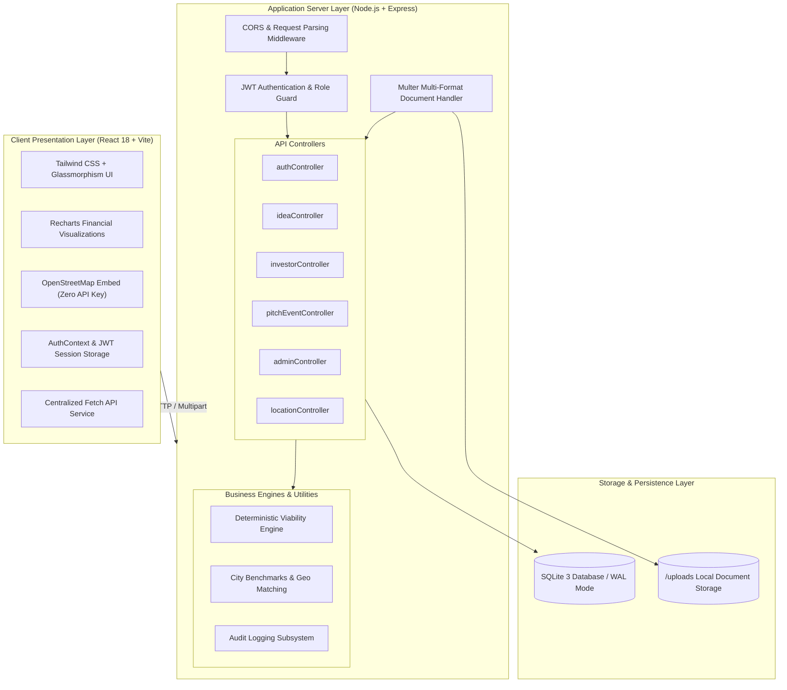

# Ideologist — System Architecture

---

## 1. Architectural Style & Design Principles

Ideologist employs a **Decoupled Multi-Tier Architecture** emphasizing simplicity, robustness, and academic transparency:

1. **Separation of Concerns:** Distinct separation between frontend presentation, REST API routing, business calculation engines, and persistence layers.
2. **Deterministic Computations:** Business viability scoring is decoupled from database queries and resides in pure mathematical utility functions, facilitating isolated unit testing.
3. **Zero External Paid Dependencies:** The architecture avoids third-party paid map APIs, proprietary cloud buckets, or external OAuth services, ensuring the entire system runs locally on any laptop or classroom projector.
4. **Resilient Local Document Vault:** Pitch materials are stored in a dedicated server-controlled filesystem directory (`/uploads`) while metadata and relative paths are preserved in SQLite.

---

## 2. Layered Breakdown

### A. Presentation Layer (React 18 + Vite)
- **Single Page Application (SPA):** Fast, client-side routing via React Router DOM v6.
- **Design System:** Custom dark navy palette (`#0B0F19`, `#111827`, `#10B981`, `#F59E0B`, `#3B82F6`) with glassmorphism panels and responsive typography.
- **Visual Analytics:** Interactive unit economics and cashflow charts rendered using Recharts.
- **Embedded Geospatial View:** Zero-dependency OpenStreetMap iframe integration centered on target cities.

### B. Application Server Layer (Express.js)
- **Centralized REST Endpoints:** RESTful organization adhering to HTTP standards (`GET`, `POST`, `PUT`, `DELETE`).
- **Role-Based Access Control (RBAC):** Middleware checks verify user tokens and enforce role privileges (`entrepreneur`, `investor`, `admin`).
- **Multer Upload Pipeline:** Intercepts multipart requests, validates file extensions and MIME types (`.pdf`, `.ppt`, `.pptx`, `.doc`, `.docx`), enforces a 10MB size ceiling, and sanitizes filenames.

### C. Business Engines & Utilities
- **`scoringEngine.js`:** Pure mathematical rules evaluating net cashflow, break-even months, funding ask sanity, and competitive rivalry.
- **`locationData.js`:** Static reference dictionary providing economic indices, commercial cost multipliers, and technology talent metrics for 10 regional startup hubs.

### D. Persistence Layer (SQLite3)
- Uses Node.js native `DatabaseSync` / SQLite with Write-Ahead Logging (`WAL`) mode enabled.
- Foreign keys with `ON DELETE CASCADE` maintain referential integrity across ideas, documents, applications, and bookmarks.

---

## 3. Technology Stack Justification

| Technology | Selection Rationale |
| :--- | :--- |
| **React 18 + Vite** | Extremely fast hot-module replacement (HMR), lightweight build footprint, and modular component reusability. |
| **Node.js + Express** | Ubiquitous asynchronous I/O, straightforward routing, and extensive ecosystem for file streaming and authentication. |
| **SQLite3 (Native)** | Zero database installation overhead (no Docker or MySQL service required); single portable `.sqlite` file that persists data reliably across server restarts. |
| **Tailwind CSS** | Utility-first styling enabling precise design system implementation without runtime CSS bloat. |
| **Recharts** | Declarative charting built specifically for React, providing responsive bar charts and metrics comparisons. |
| **OpenStreetMap** | High quality, privacy-respecting geospatial visualization without paid Google Maps API keys or credit card requirements. |
