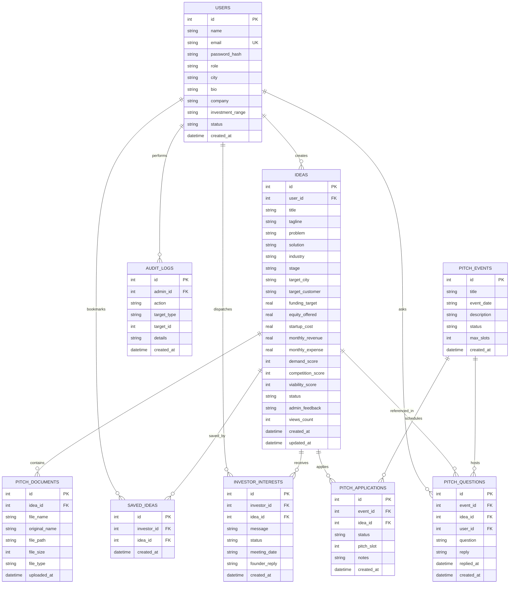

# Ideologist — Database Design & Data Dictionary

---

## 1. Schema Tables Dictionary

### Table: `users`
Stores user identity, role, and authentication credentials.

| Column | Type | Constraints | Description |
| :--- | :--- | :--- | :--- |
| `id` | INTEGER | PRIMARY KEY, AUTOINCREMENT | Unique user identifier |
| `name` | TEXT | NOT NULL | User's full name |
| `email` | TEXT | UNIQUE, NOT NULL | Login email address |
| `password_hash` | TEXT | NOT NULL | Bcrypt hashed password |
| `role` | TEXT | NOT NULL, CHECK(`role` IN ('entrepreneur','investor','admin')) | Access privilege role |
| `city` | TEXT | NULL | Base city location |
| `bio` | TEXT | NULL | Professional biography |
| `company` | TEXT | NULL | Organization / Syndicate name |
| `investment_range` | TEXT | NULL | Investor ticket size range |
| `preferred_industries`| TEXT | NULL | Investor industry focus |
| `status` | TEXT | DEFAULT 'active', CHECK IN ('active','suspended') | Account status |
| `created_at` | DATETIME | DEFAULT CURRENT_TIMESTAMP | Registration timestamp |

---

### Table: `ideas`
Stores entrepreneurial startup submissions, market parameters, and financial projections.

| Column | Type | Constraints | Description |
| :--- | :--- | :--- | :--- |
| `id` | INTEGER | PRIMARY KEY, AUTOINCREMENT | Unique idea identifier |
| `user_id` | INTEGER | NOT NULL, FK `users(id)` ON DELETE CASCADE | Founder foreign key |
| `title` | TEXT | NOT NULL | Venture title |
| `tagline` | TEXT | NOT NULL | High-impact business summary |
| `problem` | TEXT | NOT NULL | Market problem statement |
| `solution` | TEXT | NOT NULL | Proposed product/service solution |
| `industry` | TEXT | NOT NULL | Industry sector |
| `stage` | TEXT | NOT NULL, CHECK IN ('Idea','Prototype','MVP','Early Traction','Scaling') | Business development stage |
| `target_city` | TEXT | NOT NULL | Primary launch city |
| `target_customer`| TEXT | NOT NULL | Target demographic persona |
| `funding_target` | REAL | NOT NULL | Target funding requirement (INR) |
| `equity_offered` | REAL | NOT NULL | Equity percentage offered |
| `startup_cost` | REAL | NOT NULL | Initial capital expenditure (INR) |
| `monthly_revenue`| REAL | NOT NULL | Projected monthly gross revenue (INR) |
| `monthly_expense`| REAL | NOT NULL | Projected monthly operating expenses (INR) |
| `demand_score` | INTEGER | DEFAULT 75 | Market demand rating (0–100) |
| `competition_score`| INTEGER| DEFAULT 60 | Competitive rivalry index (0–100) |
| `viability_score`| INTEGER | NOT NULL DEFAULT 50 | Calculated composite score (0–100) |
| `status` | TEXT | DEFAULT 'Pending Review', CHECK IN ('Draft','Pending Review','Published','Rejected') | Moderation lifecycle status |
| `admin_feedback`| TEXT | NULL | Review feedback from administrator |
| `views_count` | INTEGER | DEFAULT 0 | Investor view impressions |
| `created_at` | DATETIME | DEFAULT CURRENT_TIMESTAMP | Submission timestamp |
| `updated_at` | DATETIME | DEFAULT CURRENT_TIMESTAMP | Last modified timestamp |

---

### Table: `pitch_documents`
Stores metadata and relative file paths of uploaded pitch decks.

| Column | Type | Constraints | Description |
| :--- | :--- | :--- | :--- |
| `id` | INTEGER | PRIMARY KEY, AUTOINCREMENT | Unique document ID |
| `idea_id` | INTEGER | NOT NULL, FK `ideas(id)` ON DELETE CASCADE | Associated idea foreign key |
| `file_name` | TEXT | NOT NULL | Sanitized server-side filename |
| `original_name` | TEXT | NOT NULL | Original upload filename |
| `file_path` | TEXT | NOT NULL | Absolute or relative filesystem path |
| `file_size` | INTEGER | NOT NULL | File size in bytes |
| `file_type` | TEXT | NOT NULL | File extension (`pdf`, `pptx`, etc.) |
| `uploaded_at` | DATETIME | DEFAULT CURRENT_TIMESTAMP | Upload timestamp |

---

### Table: `saved_ideas`
Stores investor bookmarks / watchlists.

| Column | Type | Constraints | Description |
| :--- | :--- | :--- | :--- |
| `id` | INTEGER | PRIMARY KEY, AUTOINCREMENT | Unique bookmark ID |
| `investor_id` | INTEGER | NOT NULL, FK `users(id)` ON DELETE CASCADE | Investor foreign key |
| `idea_id` | INTEGER | NOT NULL, FK `ideas(id)` ON DELETE CASCADE | Startup idea foreign key |
| `created_at` | DATETIME | DEFAULT CURRENT_TIMESTAMP | Bookmark timestamp |
| *Constraint* | UNIQUE(`investor_id`, `idea_id`) | Prevents duplicate saves |

---

### Table: `investor_interests`
Stores investment inquiries and meeting requests sent from investors to founders.

| Column | Type | Constraints | Description |
| :--- | :--- | :--- | :--- |
| `id` | INTEGER | PRIMARY KEY, AUTOINCREMENT | Unique inquiry identifier |
| `investor_id` | INTEGER | NOT NULL, FK `users(id)` ON DELETE CASCADE | Investor sender foreign key |
| `idea_id` | INTEGER | NOT NULL, FK `ideas(id)` ON DELETE CASCADE | Target startup foreign key |
| `message` | TEXT | NOT NULL | Introduction & diligence inquiry |
| `status` | TEXT | DEFAULT 'Pending', CHECK IN ('Pending','Accepted','Declined') | Request status |
| `meeting_date` | TEXT | NULL | Proposed meeting window or video link |
| `founder_reply` | TEXT | NULL | Official response from startup founder |
| `created_at` | DATETIME | DEFAULT CURRENT_TIMESTAMP | Inquiry timestamp |

---

### Table: `pitch_events`
Stores scheduled Virtual Shark Tank pitching rounds.

| Column | Type | Constraints | Description |
| :--- | :--- | :--- | :--- |
| `id` | INTEGER | PRIMARY KEY, AUTOINCREMENT | Unique event identifier |
| `title` | TEXT | NOT NULL | Event title |
| `event_date` | TEXT | NOT NULL | Scheduled presentation date/time |
| `description` | TEXT | NOT NULL | Event description & focus theme |
| `status` | TEXT | DEFAULT 'Upcoming', CHECK IN ('Upcoming','Live Demo','Completed') | Session state |
| `max_slots` | INTEGER | DEFAULT 5 | Maximum startup presentation slots |
| `created_at` | DATETIME | DEFAULT CURRENT_TIMESTAMP | Creation timestamp |

---

### Table: `pitch_applications`
Tracks founder applications to pitch in scheduled Shark Tank events.

| Column | Type | Constraints | Description |
| :--- | :--- | :--- | :--- |
| `id` | INTEGER | PRIMARY KEY, AUTOINCREMENT | Application identifier |
| `event_id` | INTEGER | NOT NULL, FK `pitch_events(id)` ON DELETE CASCADE | Event foreign key |
| `idea_id` | INTEGER | NOT NULL, FK `ideas(id)` ON DELETE CASCADE | Startup foreign key |
| `status` | TEXT | DEFAULT 'Pending', CHECK IN ('Pending','Approved','Rejected') | Application status |
| `pitch_slot` | INTEGER | NULL | Assigned presentation sequence number |
| `notes` | TEXT | NULL | Founder pitch notes |
| `created_at` | DATETIME | DEFAULT CURRENT_TIMESTAMP | Application timestamp |
| *Constraint* | UNIQUE(`event_id`, `idea_id`) | Prevents duplicate applications |

---

### Table: `pitch_questions`
Live Q&A threads between attendees/investors and presenting founders.

| Column | Type | Constraints | Description |
| :--- | :--- | :--- | :--- |
| `id` | INTEGER | PRIMARY KEY, AUTOINCREMENT | Question ID |
| `event_id` | INTEGER | NOT NULL, FK `pitch_events(id)` ON DELETE CASCADE | Event foreign key |
| `idea_id` | INTEGER | NOT NULL, FK `ideas(id)` ON DELETE CASCADE | Startup foreign key |
| `user_id` | INTEGER | NOT NULL, FK `users(id)` ON DELETE CASCADE | Question asker foreign key |
| `question` | TEXT | NOT NULL | Question text |
| `reply` | TEXT | NULL | Founder's official answer |
| `replied_at` | DATETIME | NULL | Timestamp of response |
| `created_at` | DATETIME | DEFAULT CURRENT_TIMESTAMP | Question timestamp |

---

### Table: `audit_logs`
Administrative action audit trail.

| Column | Type | Constraints | Description |
| :--- | :--- | :--- | :--- |
| `id` | INTEGER | PRIMARY KEY, AUTOINCREMENT | Log entry ID |
| `admin_id` | INTEGER | FK `users(id)` ON DELETE SET NULL | Administrator foreign key |
| `action` | TEXT | NOT NULL | Operational action code |
| `target_type` | TEXT | NOT NULL | Entity table (`ideas`, `users`, etc.) |
| `target_id` | INTEGER | NULL | Target row ID |
| `details` | TEXT | NULL | JSON or string operational summary |
| `created_at` | DATETIME | DEFAULT CURRENT_TIMESTAMP | Action timestamp |

---

## 2. Normalization & Integrity

- **Third Normal Form (3NF):** All tables are normalized to 3NF. Transitive dependencies are removed, and non-key attributes depend strictly on the primary key.
- **Cascade Deletion:** `ON DELETE CASCADE` guarantees that deleting an idea cleans up related documents, applications, questions, bookmarks, and interest requests automatically.
- **Indices:** Indexes on `user_id`, `status`, `industry`, `target_city`, `investor_id`, and `event_id` ensure query response times remain sub-millisecond even across large catalogs.
